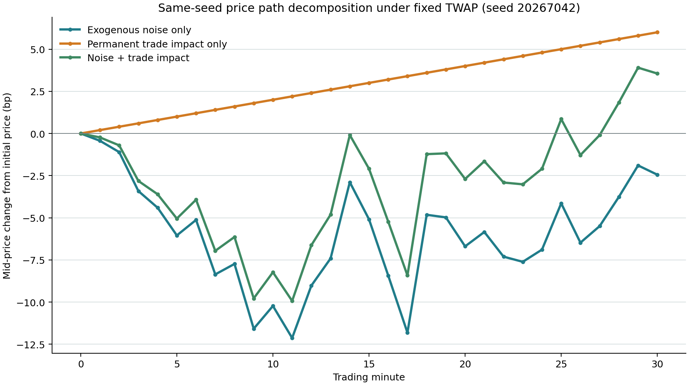

# 第七轮：市场可学习性与状态聚合

## 结果概述

本轮围绕现有30步、双机构交易模拟器回答两个有限问题：固定TWAP交易计划下，价格路径如何分解为外生扰动与永久交易冲击；将Q-learning状态中的精确剩余股数改为预先固定的比例分箱后，单学习者对TWAP的表现和行为是否变化。

处理组使用 `remaining_shares / initial_order_shares`，分箱边界为 `(0, 0.10, 0.25, 0.50, 0.75, 0.90, 1.0)`。其余状态字段、动作、Q-learning设置、市场转移、奖励和可行性计算均保持不变。动作请求、逐步限额及完单约束仍使用实际剩余股数。聚合后的状态只是近似表示，本轮不主张它满足马尔可夫性。

## 实验设计

精确库存组与比例分箱组使用相同的300个训练种子（`20267103..20267402`）、60个验证种子（`20267403..20267462`）和100个独立测试种子（`20267463..20267562`）；两组智能体的随机数种子均为 `20267101`。验证集结果只记录，没有用于选择参数或模型；测试开始前冻结Q表并关闭探索。TWAP基准使用相同的100个测试种子。

市场采用现有默认配置：每回合30步、每家机构100,000股、初始中间价100、全价差6 bp、流动性尺度20,000股、波动率2 bp、临时/永久冲击系数分别为2.0/0.6 bp每流动性单位、每步上限10,000股、手续费0.3 bp，并启用完单约束。成本是模拟器总目标成本除以初始订单名义金额，单位为bp。

## 主要结果

| 冻结测试策略 | 平均总成本（bp） | 均值95%区间 | 完成率 | 零配速动作占比 | 裁剪后动作请求量/回合 | 环境强制补足/回合 | 测试中未见状态步占比 |
|---|---:|---:|---:|---:|---:|---:|---:|
| 精确剩余股数 | 7.2221 | [5.3282, 9.1159] | 100% | 94.50% | 10,724 | 89,276 | 10.97% |
| 剩余比例分箱 | 7.0662 | [5.2046, 8.9278] | 100% | 70.50% | 64,910 | 35,090 | 1.00% |
| TWAP | 6.0149 | [4.6698, 7.3601] | 100% | 不适用 | 100,000 | 0 | 0% |

表中三项均值区间分别描述各策略在100个测试种子上的均值不确定性。使用相同测试种子计算配对差异：比例分箱减精确库存为 `-0.1559 bp`（95%区间 `[-0.3125, 0.0007]`）；比例分箱减TWAP为 `+1.0512 bp`（`[+0.3861, +1.7164]`）；精确库存减TWAP为 `+1.2071 bp`（`[+0.4998, +1.9144]`）。两种编码的成本差异在本次测试中未能与零区分；两种学习策略的成本均高于TWAP。

状态聚合将训练得到的Q状态数从2,952降至493；每状态访问次数的中位数/第90百分位由 `1/3` 升至 `13/45`，测试中未见状态步占比由10.97%降至1.00%。但有访问记录的状态-动作组合从3,215降至1,183。状态复访增多，没有带来更广的动作价值覆盖。

比例分箱策略仍在70.50%的测试步选择零配速动作。环境随后按完单约束强制补足请求量与最低可行成交量的差额。两种学习策略的100%完成率来自这一硬约束，不代表智能体独立学会了按时完成订单。聚合后，单个编码状态还可能对应不同的真实库存和合法动作集合；智能体在这些情形间共享Q值，所以这是跨异质情况的近似。

本轮结果支持一个有限判断：精确库存会产生稀疏状态，粗粒度分箱可以减少稀疏并改变交易行为；但本次状态聚合没有证实成本改善，也不能据此认定TWAP全局最优或推及真实市场。每组只训练并测试一张Q表，区间反映测试种子差异，不涵盖不同训练过程间的波动。

## 价格路径分解

图表和CSV采用固定TWAP/TWAP行动计划及seed `20267042`，按现有价格转移方程运行三种情形：仅外生扰动、仅永久交易冲击，以及二者共同作用。以对数收益计，组合路径满足 `log(C_t/C_0) = log(A_t/A_0) + log(B_t/B_0)`；最大绝对分解误差为 `3.28e-12 bp`。外生扰动是独立抽取的零均值正态噪声；单回合内价差和流动性保持不变。价格路径出现随机波动并不等于其中存在可预测信号；该图只分解模拟器内的价格来源，不构成预测结果。



## 复现与产物

在仓库根目录执行：

```powershell
python run_round7.py --output runs/round7/round7_300_60_100
python -m unittest discover -s tests_round5 -p 'test_*.py' -v
```

正式运行输出 `ROUND7_COMPLETE`；完整测试集43项通过。新增的两项针对性测试分别检查：状态合并后动作数量仍按真实库存计算；新旧Q表配置都能正确保存和加载。

正式结果位于 `runs/round7/round7_300_60_100/`，包括价格路径图及CSV、实验配置、运行回执、汇总及配对差异、训练/验证/测试指标、逐步测试轨迹、状态-动作访问分布和两张冻结Q表。运行入口为 `run_round7.py`；可选状态编码在 `src_round5/execution_sim/qlearning.py`。

## 范围说明

本轮未扩展双边IQL、未搜索参数、未更改市场模型，也未制作PPT、论文或审计压缩包。价格分解图只使用一个预先指定的seed。结论限于本报告所列模拟配置，不外推真实交易成本或市场可预测性。
