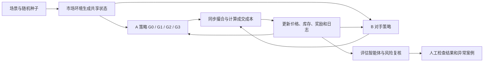

# 多智能体交易执行实验系统

本项目把课堂完整范例做成一个可本地运行、可重复的研究系统。它模拟基金 A 与基金 B 在收盘前 30 分钟同时买入母单的过程，研究动态反馈、Q-learning 和对手信息是否分别带来可测的增量价值。老师给出的是 30 分钟执行窗口，没有指定每个时间步的长度；这里选择每 30 秒决策一次，即 60 步。所有实验结果都由代码运行生成，研究假设不预设成立。

模型的状态、动作、奖励、市场反馈和训练评估流程详见[模型主要运行机制](模型主要运行机制.md)。

## 对照课堂的分层设计

| 档次 | 系统内容 | 当前状态 |
|---|---|---|
| 基础版 | A/B 两个交易主体、市场环境、可执行动作和奖励反馈；TWAP 与动态规则作可解释基线 | 已实现 |
| 标准版 | 训练一个 Q-learning 执行策略，对比 TWAP/动态规则；测试手续费冲击、高波动、拥挤交易和不同对手 | 已实现；G2 与 G3 分别测试不观察/观察对手历史动作 |
| 进阶版 | A、B 多个学习型智能体同时训练，评估策略互动、稳定性和最佳反应 | 留作扩展；本版 B 是透明的规则对手，避免把非平稳双边训练混进基准结果 |

当前训练使用正常波动环境和 TWAP、前置、后置规则对手；评估覆盖高波动、交易冲击系数翻倍、突发/随机未见对手，以及关闭对手价格冲击的消融。这样分别对应图片中的成本冲击、高波动、拥挤交易和未知对手情景。费用档位用于检验费用水平对总成本、学习回报与动作分布的影响；在必须完成全部订单、费率固定时，费用本身是每股常数项，理论上不必然改变最优执行节奏。

| 实验场景 | 模型变化 | 主要观察 |
|---|---|---|
| 正常市场 | 基础波动率、不同对手策略 | TWAP 基线及动态策略成本 |
| 成本冲击 | 单边手续费从 0.1% 提至 0.3%、0.5% | 成本、奖励/Q 值及动作分布 |
| 高波动 | 波动率设为基准的 2 倍；学习器仍在正常波动下训练 | 策略能否应对样本外波动 |
| 拥挤交易 | A、B 同时提交买单，联合订单量进入冲击计算 | 冲击、成本和对手改变后的策略表现 |
| 未知对手 | 测试时使用训练未见过的突发、随机对手 | 样本外稳健性及 G2/G3 差异 |
| 冲击压力测试 | 临时和永久冲击系数都提高到基准的 2 倍，策略保持冻结 | 基准环境学到的策略能否迁移 |
| 对手冲击消融 | 训练和评估时关闭 B 对市场价格的影响 | G3 相对 G2 的优势是否依赖真实存在的对手反馈 |
| TWAP 反向检验 | 零漂移、零价差、零永久冲击，仅保留凸性自身临时冲击 | 检查均匀执行理论基准和模拟器实现 |

## 一键运行

仅使用 Python 标准库，无需安装第三方包：

```powershell
python .\run_experiment.py
```

默认每个 Q-learning 策略、每个手续费档训练 1,200 回合；评估覆盖 3 个手续费档、2 个波动场景、4 种 A 策略、5 类 B 对手，每个组合用 30 个配对随机种子。若机器较慢，可先执行小规模烟测：

```powershell
python .\run_experiment.py --episodes 100 --seeds 5
```

要复现实验，使用相同的 `--seed`、`--episodes` 和 `--seeds`。若训练表现还未稳定，可增加 `--episodes`，并比较 `training_diagnostics.csv` 中前后训练窗口奖励及状态访问数；不要把一次小样本运行称作收敛。如果运行过程中断，命令行会给出 traceback 和重试提示，修复问题后可用相同参数重跑。系统不调用外部生成式模型 API，因此不会因模型服务拥堵而卡住；这里的学习模型是本地表格 Q-learning。

## 多智能体与对照组

| 角色/组别 | 行为 | 研究用途 |
|---|---|---|
| 市场环境 | 同步读取 A/B 决策，计算成交、手续费、暂时冲击与下一时点价格 | 提供可控反馈环境 |
| G0 固定 TWAP | 每步执行固定等额份额 | 固定计划基线 |
| G1 动态规则 | 按价格偏离和订单进度调整执行速度 | 检验动态反馈的增量价值 |
| G2 Q-learning | 根据时间、剩余订单和价格状态学习 | 检验学习策略相对动态规则的增量价值 |
| G3 对手感知 Q-learning | 在 G2 状态上增加对手上一期成交量 | 检验对手信息是否改善表现 |
| B 对手 | TWAP、前置买入、后置买入、突发买入、随机买入 | 策略矩阵和未见对手泛化测试 |
| RiskReviewAgent | 对低完成率、极端冲击或过高成本打复核标记 | 风险治理；不会发出真实订单 |

G2/G3 在 TWAP、前置和后置对手混合环境中训练；突发和随机对手留作测试。A、B 每个时间步基于同一份交易前市场状态同时决策。相同测试种子提供相同的外生市场冲击，策略导致的价格变化保留为内生市场反馈。

研究重点不是证明“运行了两个 Agent”，而是逐层检验反馈决策、强化学习和对手信息的增量价值。G3 与 G2 使用相同算法、训练预算和基础状态，区别仅为是否加入 B 上一期成交量。固定 TWAP 和动态规则本身也属于简单策略 Agent。



## 模型假设与指标

- 每家机构母单 100,000 股、30 分钟执行窗口、每步 30 秒（60 步）、初始参考价 100；所有 A 策略共享同一动作集：等待、半份、基准份、1.5 份、2 份。
- 所有 A 策略共享可行性动作屏蔽：如果继续等待将导致剩余时间内即使每步执行最大份额也无法完成，就屏蔽过小动作。这样避免 Q-learning 通过不完成订单来获得表面上的低成本。
- 成交价包含半价差、手续费和联合下单量引起的暂时冲击；下一时点中间价包含随机扰动和永久冲击。基础波动率按一分钟标准差给定，再按时间间隔平方根缩放；暂时与永久冲击按时间步长度缩放。成本档为 0.1%、0.3%、0.5%。
- 评价成本拆成毛执行缺口、显式手续费和未完成订单机会成本；训练奖励另含库存风险与终端未完成惩罚。费用档变化主要改变报告成本与奖励刻度；不能预设费用提高就会让策略改变动作。
- 所有 A 策略和学习状态共享订单完成可行性限制。候选策略后悔值仅相对于 G0–G3 候选集计算，不是全局最优或纳什均衡。
- 高波动场景使用基础波动率的 2 倍。Q 表只在正常波动下训练，高波动结果属于压力测试。
- Q-learning 状态含当前时间步、剩余母单比例和价格偏离档；G3 额外观察 B 上一期成交强度。奖励由成交实施缺口、库存风险项和终端未完成订单惩罚组成。
- 主要结果：实施缺口（bp）、完成率、未完成股数、跨种子成本标准差、动作占比和人工复核率。Q 值及训练奖励只作诊断，不单独代表经济效果。
- 模拟结论只适用于当前简化设定，不能外推为真实市场表现或交易建议。系统没有行情接口、账户凭据或真实下单能力。

## 输出文件

运行后写入 `outputs/`：

- `findings.md`：由本轮真实运行结果自动汇总的分析记录与限制；
- `evaluation_summary.csv`：每种 A 策略、B 对手和手续费档的表现；
- `paired_comparisons.csv`：同随机种子配对的策略差异与近似 95% 区间；
- `evaluation_raw.csv`：逐回合种子结果，可复核或重新统计；
- `training_diagnostics.csv`：训练奖励、初始状态 max Q 和状态访问诊断；
- `sample_episode_trace.csv`：0.5% 成本、高波动下 G3 对突发对手的逐步样例，含状态、Q 值、判断、动作、反馈和业务解释；
- `candidate_set_regret*.csv`：按对手和种子计算的候选策略集后悔值；
- `market_impact_stress_*.csv`：冲击系数翻倍后的样本外压力测试；
- `opponent_impact_ablation_*.csv`：关闭对手价格冲击后的 G2/G3 消融和差上差比较；
- `uniform_optimality_control*.csv`：凸性临时冲击下 TWAP 反向检验；
- `qtable_*.json`：训练后的策略表，可由 `load_q_table(...)` 载入继续评估或扩展实验；
- `run_manifest.json`：代码运行时的参数、种子、版本和耗时。

## 实验解释边界

策略表现应按实际结果判读。若 G3 没有胜过 G2，可能说明对手历史行动在该环境中信息有限；若 Q-learning 没有稳定优于 G1，应报告这一结果并检查训练覆盖。冻结策略后更换对手检验的是泛化；测试期间继续更新才是在线适应。本版没有实现双 Q-learning 同时训练，避免把非平稳训练混入必要的基准检验；可在 G0–G3 结果稳定后再扩展。
